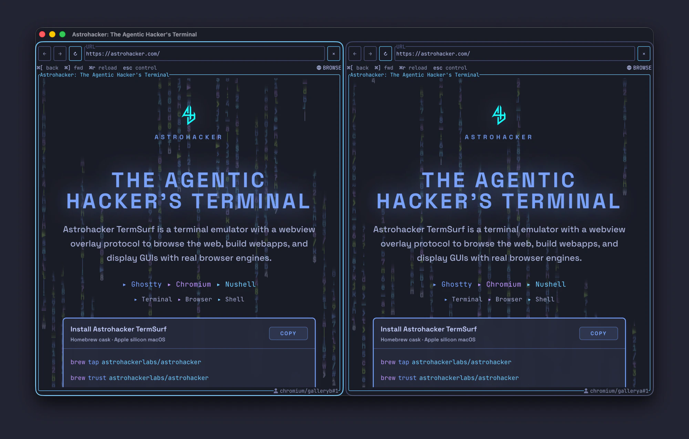
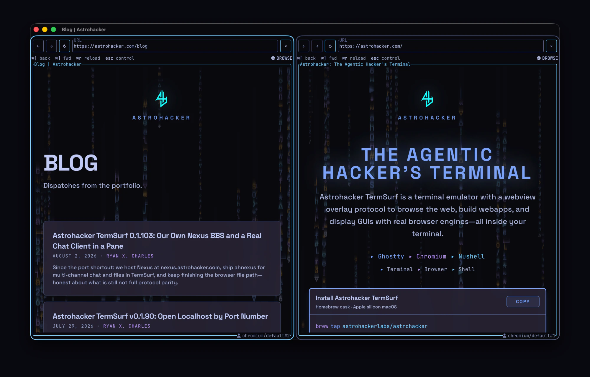
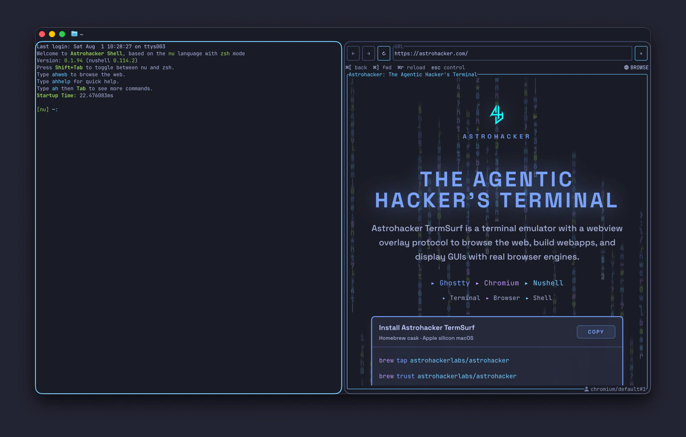
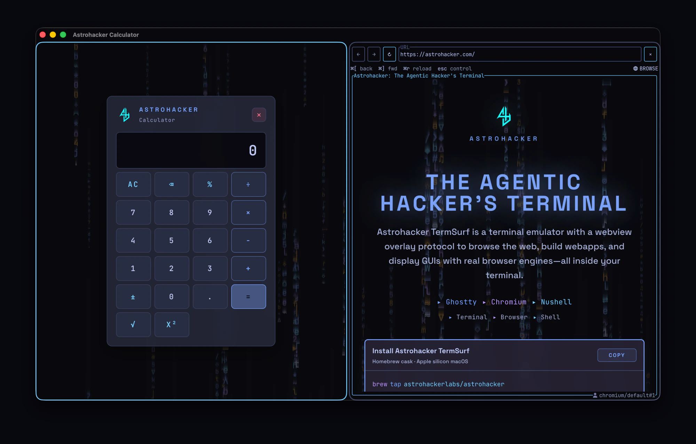
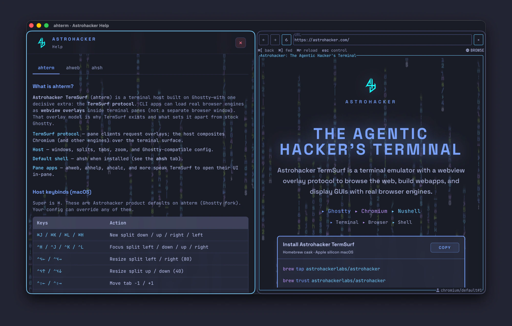
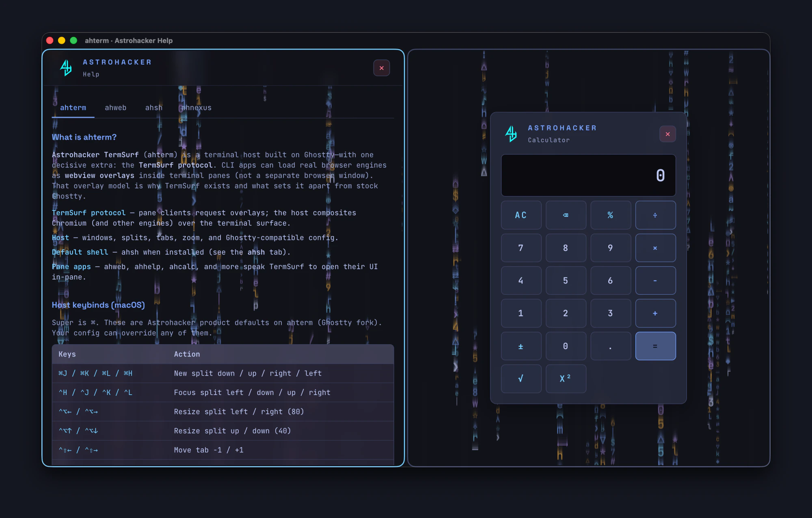
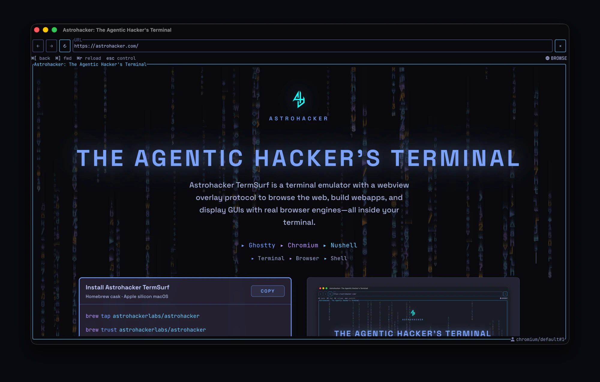
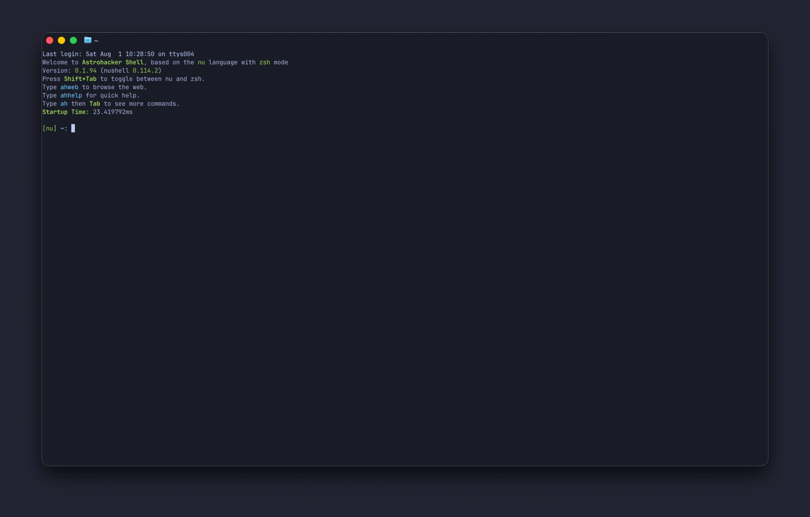

# Astrohacker TermSurf

**Astrohacker TermSurf** is a desktop host with a real browser in the pane. Run
`roamari`, open a URL, and the page appears alongside shells and other terminal
workflows.

Open a site in a browser pane:

```bash
roamari astrohacker.com
```

Open the same site under a named browser profile (separate cookies and logins):

```bash
roamari astrohacker.com --profile work
```

**TermSurf apps** are native graphical apps that run inside your terminal with
real GUIs based on web technologies. Two examples ship with the product:

Open the scientific calculator:

```bash
ahcalc
```

This public repository contains the open source client material synced from the
private Astrohacker monorepo for source releases. It includes:

- `assets/` — the canonical TermSurf mark (`termsurf.svg`) and its generated
  `termsurf-<theme>-<size>.<format>`/dock projections, plus product story screenshots under
  `assets/screenshots/story/`.
- `docs/` — product docs and public legal/records.
- `scripts/` — public build/install helpers and smoke scripts.
- `rust/` — TermSurf client/protocol/native support code.
- `patches/` — **shipped** fork patch archives, per-fork READMEs, and
  `release-manifest.json` (Chromium, Ghostty, Nushell, Reedline, plus
  historical WebKit/Gecko/Ladybird records).

Large upstream fork checkouts and build outputs are **not** committed here
(`forks/` is intentionally empty/gitignored). You reconstruct local engine and
host workspaces from `patches/` before a from-source build.

## Screenshots

Product story shots from a real Astrohacker TermSurf window (multi-profile
first, then composition, then solo surfaces).

### Two different browser profiles in one window



### Two real browser panes at once



### Shell and browser, same window



### Product apps beside the web



### Docs beside the web



### Apps compose with apps



### Browse the web inside your terminal



This is Astrohacker TermSurf: a normal terminal window with a real Chromium
browser running as a pane—same app, same window, not a separate browser you
alt-tab to.

### Still a terminal when you want one



## Install

The Astrohacker Homebrew cask targets Apple silicon macOS and installs into
`/Applications` as **Astrohacker TermSurf.app**:

```nu
brew trust astrohackerlabs/astrohacker
brew tap astrohackerlabs/astrohacker
brew install --cask termsurf
```

To upgrade:

```nu
brew update
brew upgrade --cask termsurf
```

## Build

Most people should use the **Install** section above. Building from this repo
is for developers who want a patched engine and host from source.

### What this repo includes (and what it does not)

| Included | Not included |
| --- | --- |
| Client source under `code/`, scripts, docs, assets | Pre-built engines or app bundles |
| **`patches/`** — full `.patch` archives + reconstruction notes | Checked-in `forks/` trees (Chromium, Ghostty, …) |
| `patches/release-manifest.json` — exact bases, heads, ordered patch dirs | Automatic one-command clone of Chromium (you reconstruct manually) |

`scripts/build.nu` only **compiles** workspaces that already exist under
`forks/`. If `forks/chromium/src` (or Ghostty, etc.) is missing, the script
skips that component — it does **not** download upstream or apply patches for
you.

### Prerequisites

Typical host: **Apple silicon macOS**, with:

- Xcode (and command-line tools)
- Zig, at the version Ghostty's `forks/ghostty/build.zig.zon` names in
  `minimum_zig_version` (same major.minor). Homebrew's plain `zig` tracks the
  newest release and may not match, so install the versioned keg-only formula.
  `scripts/build.nu` finds it, or stops and prints the exact
  `brew install zig@<major>.<minor>` command.
- Rust (`rustup`)
- Bun (for TermSurf apps that need it)
- Chromium **`depot_tools`** and a full Chromium source checkout workflow
  (large disk + long first build)

```bash
curl --proto '=https' --tlsv1.2 -sSf https://sh.rustup.rs | sh
curl -fsSL https://bun.sh/install | bash
```

Install Chromium `depot_tools` and follow Google’s Chromium macOS setup for
fetching source (this repo does not vendor Chromium).

### Reconstruct forks from patches (required before build)

1. Read **`patches/README.md`** and the machine-readable pin
   **`patches/release-manifest.json`** (ordered `patch_directories`, `base`,
   `expected_head` / `expected_tree` per shipped fork).
2. For each fork you need, follow that fork’s README (clone/checkout **base**,
   create the product branch, **`git am`** the ordered archives):

   | Fork | Checkout path | Docs |
   | --- | --- | --- |
   | Chromium (shipped engine) | `forks/chromium/src` | [`patches/chromium/README.md`](patches/chromium/README.md) |
   | Ghostty (host / `termsurf`) | `forks/ghostty` | [`patches/ghostty/README.md`](patches/ghostty/README.md) |
   | Nushell | `forks/nushell` | [`patches/nushell/README.md`](patches/nushell/README.md) |
   | Reedline | `forks/reedline` | [`patches/reedline/README.md`](patches/reedline/README.md) |

   WebKit / Gecko / Ladybird under `patches/` are **historical** only — not
   required for a current product build.

3. Pattern (simplified; **use the base SHA and archive list from the
   release-manifest + per-fork README**, not invent paths):

   ```nu
   # Run from the repository root after provisioning the fork and recorded base.
   let entry = (open patches/release-manifest.json | get forks | where name == ghostty | first)
   let root = $env.PWD
   let files = ($entry.patch_directories | each {|dir|
     glob ($root | path join $dir '*.patch') | sort
   } | flatten)
   git -C $entry.checkout switch -c $entry.branch $entry.base
   if not ($files | is-empty) { git -C $entry.checkout am ...$files }
   ```

   Chromium’s base is an Electron Chromium tag/commit recorded in the
   manifest; fetch that tree with `depot_tools` / your usual Chromium workflow
   into `forks/chromium/src`, then apply the Chromium series the same way.

4. Confirm the reconstructed tree matches `expected_tree` and the ordered patch
   identities/count match the selected archive. Record `git rev-parse HEAD`
   separately: replaying the same patches can change commit hashes, so equality
   with `expected_head` alone is not the reconstruction oracle. In the internal
   Astrohacker monorepo, `ah fork check <name>` performs the full readiness check;
   see its `patches/AGENTS.md` for preparation and export tooling.

Expect a **large** Chromium build (many GB, often hours on first compile).

### Compile client components

After forks are reconstructed and (for Chromium) built as needed:

```nu
scripts/build.nu chromium      # Chromium fork / roamari-chromiumd path
scripts/build.nu roamari
scripts/build.nu ahterm
```

Release-style local build (still requires reconstructed forks):

```nu
scripts/build.nu termsurf --release
```

The host app bundle (when the Ghostty/`ahterm` build component succeeds) is written to:

```text
forks/ghostty/macos/build/Release/Astrohacker TermSurf.app
```

## Run

During development, launch the Ghostty-based host from the reconstructed
Ghostty workspace:

```nu
cd forks/ghostty
^(nu ../../scripts/lib/zig-toolchain.nu) build -Demit-macos-app=false
cd macos
./build.nu --configuration Debug --action build
```

Inside Astrohacker TermSurf, run a local `roamari` and point it at a built
engine (paths after a successful Chromium/`roamari-chromiumd` build):

```bash
./target/debug/roamari \
  --browser ./forks/chromium/src/out/Default/roamari-chromiumd \
  https://example.com
```

## License

See `LICENSE`, `NOTICE`, and `TRADEMARKS.md`.
